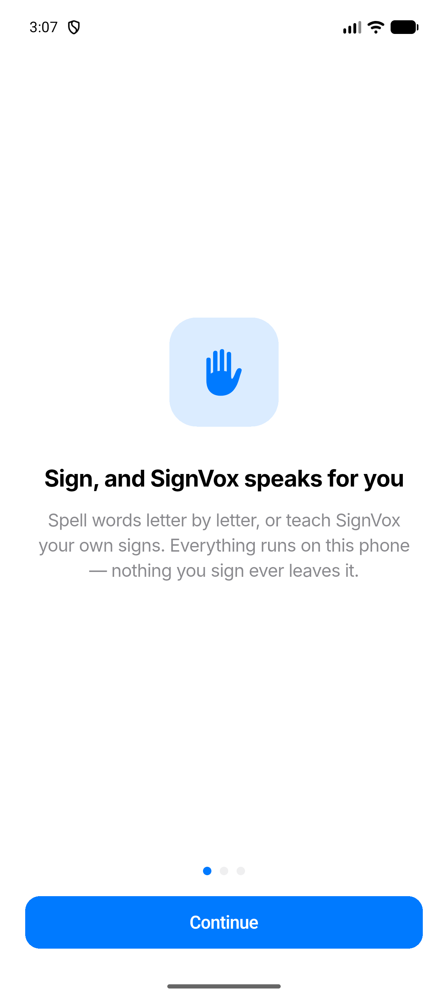
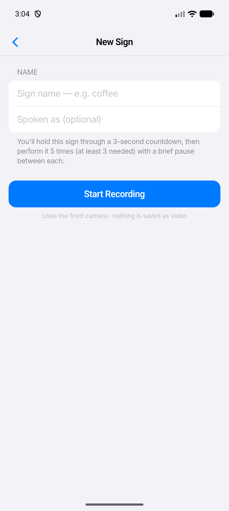
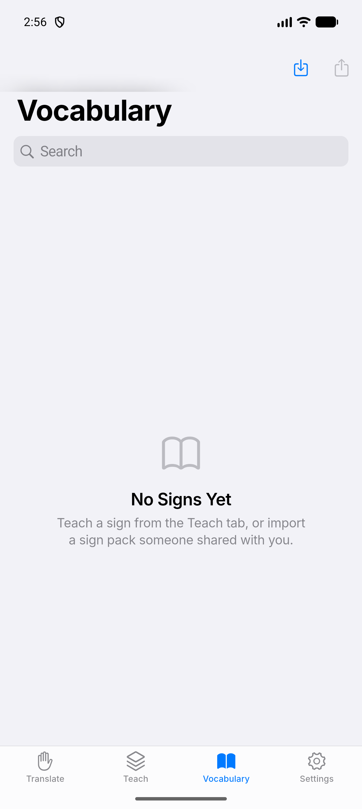
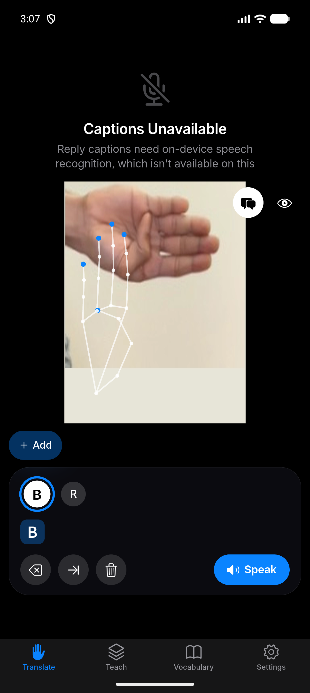
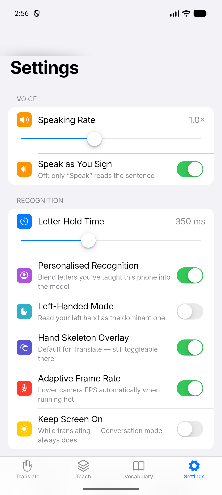
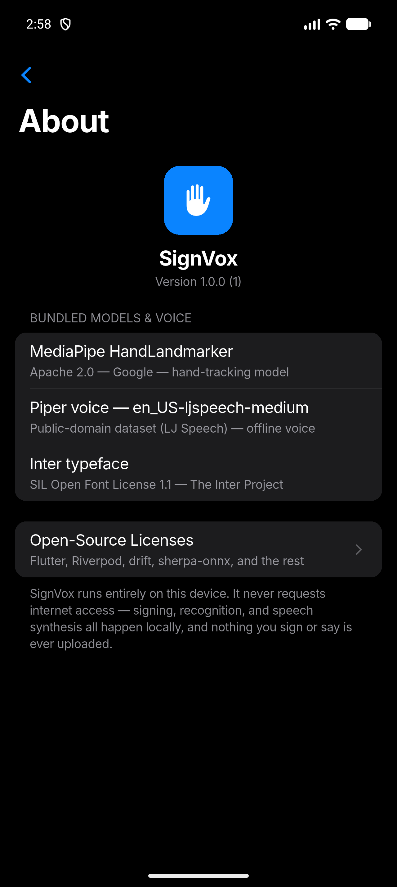

# SignVox

**Sign at your phone's front camera — it speaks for you, out loud, in a natural voice. Entirely offline.**

SignVox is an Android app for anyone who signs and wants to be understood by someone who doesn't. Spell words letter by letter, or teach it your own signs, and it speaks them back immediately in a bundled neural voice — no internet connection, ever. It also has a Conversation mode with a live, on-device speech-to-text transcript of the other side of the exchange.

Built for [Dhiva Labs](https://github.com/Dhiva-Labs).

## Why offline matters here

Sign language is often used in exactly the situations where sending video or audio to a server would be the wrong tradeoff — privacy, connectivity, and speed all point the same way. SignVox's hand tracking, recognition, and speech synthesis all run as on-device inference. The app never requests the `INTERNET` permission at all (verified on every release build — see [Privacy](#privacy)).

## Screenshots

| Onboarding | Teach a sign | Vocabulary |
|---|---|---|
|  |  |  |

| Conversation mode (dark) | Settings | About |
|---|---|---|
|  |  |  |

## Features

- **Spell mode** — fingerspell words letter by letter; a small on-device model recognizes each handshape and speaks committed words as you go. A live candidate bar shows the top three guesses with a progress ring on the letter that's about to commit.
- **Word suggestions** — after a letter or two, one-tap chips complete the whole word from an offline English frequency list, so a conversation doesn't wait for every letter to be spelled.
- **Auto-correction** — a spelled word that ends up one letter off a common English word (HELLN) is repaired before it's spoken. One confused handshape no longer ruins the word. Toggleable in Settings.
- **Numbers mode** — an ABC/123 switch for fingerspelled digits 0–9. ASL shares handshapes between digits and letters (0=O, 2=V, 6=W, 9=F), so digits are mode-gated the way real signers disambiguate by context; recognition combines hand geometry (finger extension + thumb contact) with the letter ensemble for the shared shapes.
- **Personalised recognition** — optionally teach the app *your* hand, letter by letter. It stores a compact per-letter fingerprint on the device (never the images, never uploaded) and blends it into recognition, so one global model doesn't have to fit every hand.
- **Signs mode** — teach SignVox your own two-handed signs (5 quick samples each) and it recognizes and speaks them live, using dynamic time warping — no training pipeline, no dataset licensing risk, your signs stay your own data.
- **Conversation mode** — a split view: a live on-device speech-to-text transcript of the person you're talking to on top, your signing below, plus one-tap quick phrases.
- **Vocabulary** — manage every taught sign: enable/disable, override what's actually spoken, export/import as a sign pack (JSON) to share with another device.
- **History** — every spoken sentence, with a tap to re-speak or save as a quick phrase.
- **Natural voice** — a bundled neural (Piper/sherpa-onnx) voice, not the robotic system TTS, with adjustable speaking rate.
- **A design that gets out of the way** — an Apple-HIG-style interface: full-bleed camera under frosted-glass controls, iOS-style large-title navigation and grouped settings, true-black dark mode, haptic ticks as letters and words commit.

## Tech stack

| Layer | Choice |
|---|---|
| App framework | Flutter (Android only), Riverpod for shared state |
| Design system | Apple-HIG grammar in Material: Inter typeface (OFL 1.1), iOS semantic palette, frosted glass, Cupertino transitions/dialogs/switches (`lib/theme.dart` + `lib/ui/widgets/`) |
| Camera + hand tracking | CameraX + MediaPipe Tasks HandLandmarker (Kotlin, GPU→CPU fallback) |
| Letter recognition | Ensemble of five small MLPs (135→256→128→27, independently seeded and calibrated, probabilities averaged), pure-Dart inference, trained on permissively-licensed public ASL photo datasets + optional on-device personalisation |
| Sign recognition | Dynamic time warping (DTW) + 1-NN over user-taught exemplars |
| Voice | sherpa-onnx running a bundled Piper voice (`en_US-ljspeech-medium`), `flutter_tts` as a loading/failure fallback |
| Speech-to-text | `speech_to_text`, gated to on-device-only recognition (see [Privacy](#privacy)) |
| Storage | `drift` (SQLite) for signs/exemplars/history/phrases; `shared_preferences` for settings |

The whole recognition spine downstream of the landmarks is plain, unit-tested Dart: `lib/core/` (normalization, smoothing, segmentation, controllers) and `lib/engines/` (letter MLP, features, decoder, DTW, word suggestions). Only the camera and MediaPipe live in Kotlin (`android/app/src/main/kotlin/`), and only landmark coordinates ever cross the platform channel.

## Building it

Requirements: Flutter (stable channel), Android SDK with `minSdk 24`+, and a device or emulator with a camera.

```bash
flutter pub get
flutter run
```

Release build:

```bash
flutter build apk --release   # universal APK
flutter build appbundle       # Play Store AAB, per-ABI splitting
```

The release APK bundles native libraries for all four Android ABIs plus the ~78 MB bundled voice — a real device only ever installs one ABI's slice; the AAB is the right artifact for actual distribution.

Tests:

```bash
flutter test
flutter analyze
```

## Privacy

SignVox's release build declares exactly two permissions: `CAMERA` and `RECORD_AUDIO` (the latter only for Conversation mode's optional reply transcript). No `INTERNET`, no `ACCESS_NETWORK_STATE` — nothing that could reach a network even if it wanted to. This has been checked with `aapt dump permissions` after every phase of development.

Conversation mode's speech-to-text specifically checks Android's `SpeechRecognizer.isOnDeviceRecognitionAvailable()` before ever starting to listen, and simply shows an honest "not available on this device" message rather than falling back to a network-backed recognizer — a real gap in the underlying `speech_to_text` package's own behavior (its `onDevice` flag silently falls back to a cloud-eligible recognizer) that SignVox closes with its own native check.

## Model provenance and data licenses

The bundled letter model (`assets/models/letters_weights.json`) is trained
**only** on public datasets whose licenses permit commercial use and
redistribution of derived weights — MIT, Apache-2.0 or CC0 — plus synthetic
hand-transition frames derived from those same landmarks. Every candidate
dataset that was considered, and the reason each was accepted or rejected, is
recorded in [tools/DATA_LICENSES.md](tools/DATA_LICENSES.md). Several
permissively-*labelled* datasets were rejected there because their contents are
re-uploads of restrictively-licensed data; a license tag on a re-upload does not
re-license the original.

Recognition accuracy is measured against a completely held-out source
(`danrasband/asl-alphabet-test`, CC0) that never appears in training — an
in-dataset score alone would flatter the model considerably.

## Licenses

- **MediaPipe HandLandmarker** — Apache 2.0, Google.
- **Piper voice (`en_US-ljspeech-medium`)** — trained on the public-domain LJ Speech dataset; see [assets/tts/LICENSE](assets/tts/LICENSE) for why this voice was chosen over the originally-planned one.
- **Inter typeface** — SIL Open Font License 1.1 ([assets/fonts/OFL.txt](assets/fonts/OFL.txt)).
- **Word-suggestion list** — MIT, from the FrequencyWords project ([assets/wordlist/LICENSE](assets/wordlist/LICENSE)).
- Every other bundled package's license is listed in-app: Settings → About → Open-source package licenses.

## Current status

Built and verified phase-by-phase (P0–P7) on an Android emulator with a host-webcam passthrough for the front camera. Honestly still pending, because they need real hardware or a real recorded dataset:

- Recognition-accuracy numbers against an actual signing hand, on an actual device. The bundled model is trained on real public-dataset hands and ships as a five-member ensemble: on a fully unseen source, individual seeds ranged 69–76% (the public eval set is small enough that single numbers carry ±2–3 points of noise) while the ensemble locks in above-the-seed-mean accuracy with the strongest phantom-letter rejection measured so far. In-dataset held-out accuracy is 99.3%. A photo dataset is not a person signing at a phone — the intended accuracy path is per-user: the Improve Recognition calibration flow, and eventually a Data Lab-recorded dataset.
- Whether the on-device personalisation flow measurably helps a real user's weak letters.
- Real-device latency/FPS numbers and adaptive-frame-rate behavior under real thermal throttling.
- Conversation mode's live transcript, end-to-end, on a device with the on-device speech model installed (Android 12+).
